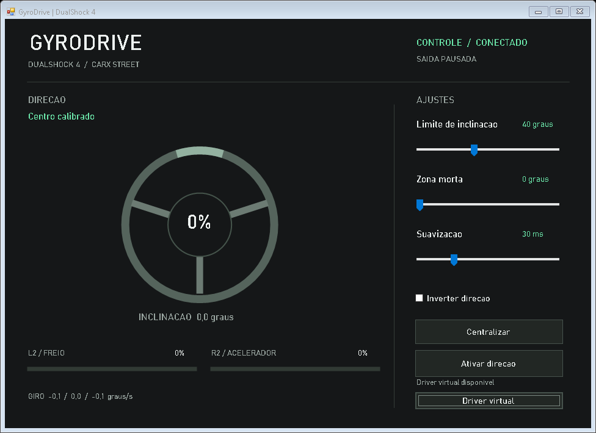

# GyroDrive PC

**Windows x64 | DualShock 4 | 0.1.1-beta**

Direcao por inclinacao do proprio controle PS4, via USB ou Bluetooth, para jogos no PC com suporte a controle Xbox/XInput. Nao usa celular. Esta e a versao PC, separada do GyroDrive Mobile.



## Baixar e abrir

Release: https://github.com/theuslpszbr15/GyroDrive-PC/releases/tag/v0.1.1-beta

1. Baixe **GyroDrive-PC-0.1.1-beta.zip** nos Assets da release.
2. Clique com o botao direito no ZIP e escolha **Extrair tudo**. Nao execute de dentro do ZIP.
3. Abra **GyroDrive.exe** na pasta extraida. Mantenha `JoyShockLibrary.dll` e `ViGEmClient.dll` ao lado do EXE. O aplicativo e portatil; nao precisa de instalador proprio.
4. Conecte o DualShock 4 por USB ou pareie pelo Bluetooth do Windows. Para parear, segure **Share + PS** ate a luz piscar e adicione **Wireless Controller** no Windows.
5. Segure o controle na postura de jogo, parado, e clique em **Centralizar**. Aguarde **Centro calibrado**; normalmente leva 2-4 segundos depois da primeira conexao. O clique no touchpad tambem centraliza.
6. Clique em **Ativar direcao**. Abra o jogo e selecione controle Xbox. Incline o controle para dirigir; L2 e R2 encaminham freio e acelerador.

Requisitos: Windows 10/11 x64, .NET Framework 4.x e DualShock 4. Para enviar comandos ao jogo, precisa do driver legado **ViGEmBus**, separado do ZIP: https://github.com/nefarius/ViGEmBus/releases

ViGEmBus e um projeto encerrado. Avalie essa dependencia antes de instalar; use somente a fonte oficial. O driver pode exigir permissao de administrador e reinicio. O aplicativo nao instala drivers nem altera configuracoes do Windows ou do jogo automaticamente. O EXE nao tem assinatura Authenticode; confira a origem e os hashes sem desativar protecoes do sistema.

## Compatibilidade

- Entrada fisica suportada: **PS4 / DualShock 4**, com sensores proprios. Controles Xbox comuns nao possuem giroscopio e nao sao entradas de movimento suportadas por esta versao.
- A saida e um **controle Xbox 360 virtual**, nao um volante com force feedback. Os botoes, gatilhos e demais eixos padrao sao encaminhados; o eixo horizontal do analogico esquerdo e substituido pela direcao por movimento.
- USB, Bluetooth, sensores reais, calibracao e criacao do Xbox virtual foram verificados neste PC. O usuario confirmou funcionamento no **CarX Street**; isso e validacao relatada pelo usuario, nao certificacao de todos os jogos e PCs.
- Nao ha encaminhamento de vibracao. Controles genericos com nome de PS4 podem nao ter sensores compativeis.
- Esta versao usa inclinacao lateral relativa a gravidade com fusao dos sensores. Rotacao plana em torno da gravidade (yaw) nao e uma referencia absoluta de direcao.

## Ajustes e seguranca

Limite angular, zona morta, suavizacao e inversao da direcao. Mudar a postura exige nova centralizacao. Os ajustes ficam em `%LOCALAPPDATA%\GyroDrive`; erros de conexao ficam em `GyroDrive.log` ao lado do app.

Pausar, centralizar, fechar normalmente ou perder atualizacoes dos sensores neutraliza a saida virtual. Reconeccao nunca reativa a direcao automaticamente: centralize e ative novamente. Um encerramento inesperado do processo nao tem a mesma garantia de fechamento normal.

Feche outros remapeadores durante o teste. Steam Input e o controle fisico podem causar entrada duplicada ou conflito de jogador; confira qual controle o jogo utiliza. HidHide nao e instalado/configurado automaticamente. Nao teste mudancas de driver em modos online antes de conferir as regras do jogo.

## Correcao nesta beta

Corrigido o reinicio repetido da calibracao quando o giroscopio apresenta desvio inicial alto. A calibracao nativa agora pode aprender esse desvio com o controle parado; a captura do centro continua bloqueada enquanto os sensores nao estabilizam. A nova regra possui teste de regressao.

Se aparecer **Calibracao interrompida**, mantenha o controle parado e centralize novamente. Se aparecer **Sem sinal do controle**, verifique conexao e bateria. O aplicativo rescaneia dispositivos desconectados ou sem dados por 1,5 segundo; trocar USB/Bluetooth pausa a saida por seguranca.

## Desenvolver

Os fontes estao neste repositorio e em `GyroDrive-PC-Source-0.1.1-beta.zip`. Para compilar, use as DLLs oficiais incluidas no ZIP de execucao (com suas licencas) na raiz dos fontes, ao lado de `build.ps1`.

```powershell
.\build.ps1
.\GyroDrive.Checks.exe --self-test
.\GyroDrive.Checks.exe --probe
.\GyroDrive.Checks.exe --virtual-check
```

O build usa o compilador x64 do .NET Framework instalado no Windows, sem SDK moderno. `--probe` e `--ui-check preview.png` acessam o controle real: feche o app antes de executa-los para nao disputar o dispositivo. `--virtual-check` informa READY/UNAVAILABLE; leia o resultado, pois o codigo de saida sozinho nao comprova que o driver funciona.

`package.ps1` monta e verifica os ZIPs e `SHA256SUMS.txt`. Os hashes permitem conferir que os downloads sao identicos aos arquivos publicados. Logs, configuracoes pessoais, caches e executaveis de teste nao acompanham os fontes.

## Dependencias

- JoyShockLibrary 3.0, MIT, com fusao de sensores/calibracao GamepadMotionHelpers e atribuicoes HIDAPI: https://github.com/JibbSmart/JoyShockLibrary/releases/tag/v3.0. Licenca em `licenses/JoyShockLibrary.md`.
- ViGEmClient nativo, MIT, extraido do NuGet oficial `Nefarius.ViGEm.Client` 1.21.256: https://www.nuget.org/packages/Nefarius.ViGEm.Client/1.21.256. Licenca em `licenses/ViGEmClient.txt`.
- Ciclo de vida do ViGEmBus: https://docs.nefarius.at/projects/ViGEm/End-of-Life/.

Nao afiliado a Sony, Microsoft ou CarX Technologies. As licencas das dependencias nao definem a licenca do codigo proprio deste projeto.